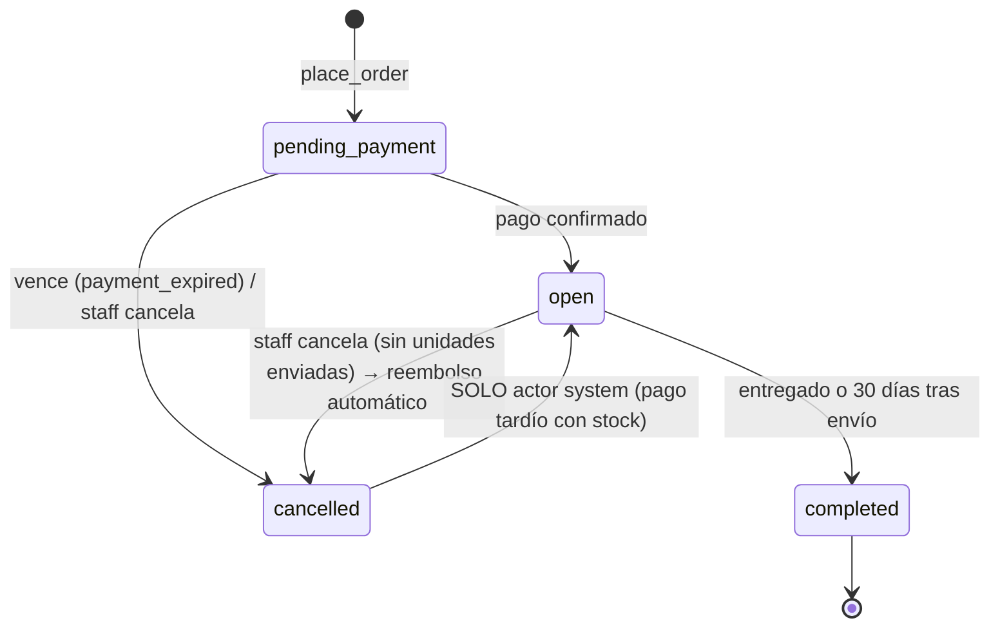
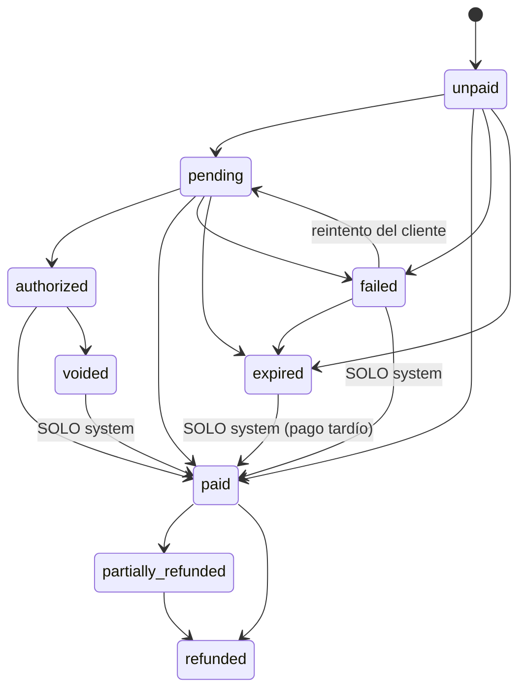
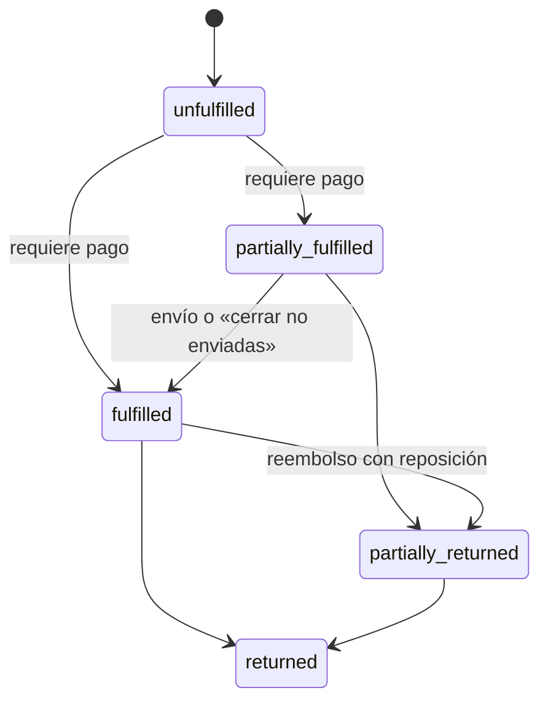
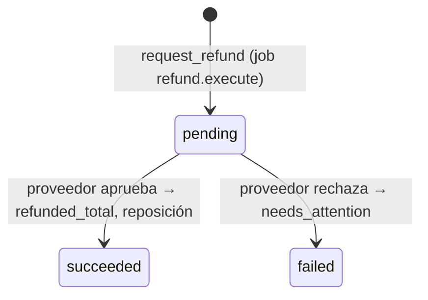

# 03 · Dinero e inventario — Súper auditoría 2026-10-27

Auditor: área de dinero e inventario (solo lectura). Prefijo de hallazgos: **DIN-**.
Alcance: carrito → checkout → pago (Mercado Pago, Stripe, manual, simulado) → webhook → correo → surtido → reembolso, más
inventario, cupones, ofertas programadas y despachos de proveedor.

Etiquetas: **[VERIFICADO]** = lo comprobé leyendo el código final o ejecutando pruebas; **[INFERIDO]** = deducido del código
sin ejecutarlo; **[NO VERIFICADO]** = depende de Mercado Pago, Resend o Vercel reales, que no están disponibles.

Glosario breve:

- **Reserva**: unidades apartadas para un pedido sin pagar; vencen a los `reservation_ttl_minutes` (10–120, por omisión 30).
- **Webhook**: aviso que el proveedor de pago envía al servidor cuando cambia un cobro.
- **Reconciliación**: tarea periódica que vuelve a preguntar al proveedor por los cobros abiertos, por si un webhook se perdió.
- **Idempotencia**: repetir la misma operación (misma clave) no duplica el efecto.
- **Contracargo**: el banco del comprador revierte un cobro ya aprobado.
- **Pago tardío**: el cobro se aprueba cuando el pedido ya venció o se canceló.

## 0. Cómo se revisó

- Definiciones finales de las funciones (tras las 120 migraciones) extraídas de la base local `pruva_dev` con
  `pg_get_functiondef` y cruzadas con su migración de origen; restricciones e índices únicos de las tablas de dinero e
  inventario leídos de `pg_constraint` / `pg_indexes`.
- TS leído: `src/server/payments/*`, `src/server/storefront/checkout.ts`, `src/app/api/webhooks/payments/*`,
  `src/server/jobs/*`, `src/server/orders/handlers.ts`, `src/server/notifications/order-handlers.ts`, `vercel.json`.
- Pruebas ejecutadas hoy (sin modificar archivos):
  - `pg_prove` sobre `pruva_test`: 27_calculate_cart, 28_place_order, 29_payments_expiry, 32_fulfillment_refunds,
    36_phase7_gate, 68_mercadopago, 77_scheduled_sales, 20_inventory → **279/280 OK**; el fallo (29 #28) es de hermeticidad
    de la prueba, no del producto (ver DIN-11).
  - Vitest integración: `mercadopago-webhook.test.ts` + `checkout-concurrency.test.ts` → **19/19 OK**.

## 1. Flujo de punta a punta (resumen)

1. **Carrito** (`storefront.cart_*`): el cliente solo envía variante y cantidad (1–999, ≤ 50 renglones). Precio, impuestos,
   envío y descuento los calcula `app.calculate_cart` / `app.cart_totals` en la base, en centavos `bigint`.
2. **Checkout** (`storefront.place_order`, `20261013000600_phase6_gate_fixes.sql:217`): bloquea el carrito `FOR UPDATE`,
   recalcula todo, compara con `p_expected_total` (solo para detectar cambios → `price_changed`), bloquea y reserva el cupón,
   crea pedido + renglones (snapshot), reserva inventario (`app.inventory_reserve`, filas bloqueadas en orden fijo) y crea el
   intento de pago con `amount = orders.total`. Todo en una transacción; `insufficient_stock` revierte todo.
3. **Pasarela** (`checkout.ts:91-138`): después del commit, `createCheckout`. Mercado Pago: preferencia con un solo concepto
   por el total, `external_reference = payments.id`, `expiration_date_to = vencimiento del intento`,
   `X-Idempotency-Key = payments.id` (`mercadopago.ts:259-304`).
4. **Webhook MP** (`mercadopago-webhook.ts:46-122`): firma HMAC → cuenta por collector → evento deduplicado
   (`payment_events` único por cuenta+evento) → **re-consulta** del cobro a MP → `system.apply_mercadopago_payment` valida
   referencia, monto y moneda y aplica.
5. **Pago confirmado** (`app.confirm_order_payment` → `app.finalize_paid_order`): compromete la reserva, `paid_total = total`,
   cupón reservado → usado, encola `order.paid` (correo de confirmación).
6. **Surtido** (`public.orders_fulfill`): solo pedidos `open` y pagados; descuenta `on_hand` y `reserved` con
   `app.apply_inventory_movement` (idempotente por envío).
7. **Reembolso** (`app.request_refund` → job `refund.execute` → `system.apply_refund_result`): monto ≤ pagado − reembolsado −
   pendiente; partidas solo de unidades enviadas; reposición opcional al inventario.

## 2. Diagramas de estado

Las transiciones permitidas están en `app.order_transition_allowed` (pedido) y en los triggers `app.payments_guard`,
`app.refunds_guard`, `app.supplier_orders_guard`. Una transición fuera de la lista lanza `invalid_transition` dentro de la
base: **ninguna ruta de código puede saltársela** [VERIFICADO].

### 2.1 Pedido (`orders.status`)

No permitidas (bloqueadas por trigger): `completed → *`, `cancelled → open` por staff/cliente, `open → pending_payment`.
**No controlada por diseño:** `cancelled` con `payment_status = paid` (pago tras cancelación o pago tardío sin stock): queda
en `needs_attention` con reembolso automático; correcto, pero depende de que el webhook llegue (DIN-01).

### 2.2 Pago del pedido (`orders.payment_status`) e intento (`payments.status`)

Intento (`payments`): `created → pending|authorized|succeeded|failed|cancelled|expired`; `expired|failed|cancelled →
succeeded` (realidad del proveedor). Índice único `payments_one_succeeded_uq`: **a lo más un intento `succeeded` por pedido**.
**Hueco:** no existe transición para contracargo/reembolso externo: `paid` nunca regresa por acción del proveedor (DIN-03).

### 2.3 Surtido (`orders.fulfillment_status`) y envío (`shipments.status`)

Envío: `shipped → delivered` (`orders_mark_delivered`). El trigger `orders_guard` impide surtir algo no pagado
(`fulfillment_requires_payment`). **No controlado:** un pedido `open/paid` con contracargo sigue siendo surtible (DIN-03).

### 2.4 Reembolso (`refunds.status`) y despacho de proveedor

Despacho de proveedor: `pending → requested → confirmed → shipped → delivered`, `failed → pending|cancelled`; se cancela
solo si está `pending` al cancelar el pedido (`app.supplier_orders_on_order_cancel`). Un despacho ya `requested` no se
cancela solo al cancelar el pedido: queda para gestión manual [VERIFICADO, por diseño].

## 3. Hallazgos

| ID     | Sev.  | Título                                                                                                                      | Etiqueta                                      |
| ------ | ----- | --------------------------------------------------------------------------------------------------------------------------- | --------------------------------------------- |
| DIN-01 | Alta  | Cobro de Mercado Pago aprobado tras el vencimiento local y con webhook perdido: nadie lo detecta                            | [VERIFICADO] código / [NO VERIFICADO] MP real |
| DIN-02 | Media | OXXO/SPEI vs reserva de 30 min: casi todo pago en efectivo será «pago tardío»                                               | [INFERIDO] / [NO VERIFICADO]                  |
| DIN-03 | Alta  | Contracargos y reembolsos hechos fuera de la plataforma se ignoran (contra GATE0 §18)                                       | [VERIFICADO]                                  |
| DIN-04 | Alta  | Runner de jobs diario (Vercel Hobby): vencimientos, reconciliación, correos, reembolsos y ofertas con hasta 24 h de retraso | [VERIFICADO] repo / [NO VERIFICADO] Vercel    |
| DIN-05 | Media | Cobro duplicado: se detecta, pero no hay forma correcta de reembolsarlo desde el panel                                      | [VERIFICADO]                                  |
| DIN-06 | Media | «Cerrar no enviadas» reembolsa sin IVA (si precios sin impuesto), sin envío y con truncamiento                              | [INFERIDO]                                    |
| DIN-07 | Media | Tolerancia de firma ±5 min podría rechazar reintentos de MP                                                                 | [NO VERIFICADO]                               |
| DIN-08 | Media | Anomalías de pago (duplicado, monto distinto) sin aviso activo al comercio                                                  | [VERIFICADO]                                  |
| DIN-09 | Baja  | Pago tardío reabierto no vuelve a contar el cupón: el límite de usos se puede rebasar                                       | [VERIFICADO]                                  |
| DIN-10 | Baja  | La reposición por reembolso siempre va a la ubicación principal                                                             | [VERIFICADO]                                  |
| DIN-11 | Baja  | pgTAP 29_payments_expiry no es hermética (falla con datos residuales)                                                       | [VERIFICADO] ejecutando                       |
| DIN-12 | Baja  | Pago simulado depende de un ajuste de base; sin candado de entorno en la base                                               | [VERIFICADO]                                  |
| DIN-13 | Baja  | Oferta programada + cupón porcentual se acumulan sin decisión escrita                                                       | [VERIFICADO]                                  |

### DIN-01 · Alta · Cobro de MP aprobado tras el vencimiento local y con webhook perdido: nadie lo detecta

**Evidencia** [VERIFICADO por lectura del código final]:

- `system.expire_orders` (`20261013000400_payments_expiry.sql:291`) pasa los intentos `created|pending|authorized` a
  `expired` **sin consultar a Mercado Pago**. La consulta al proveedor antes de vencer solo existe para Stripe:
  `system.payment_for_expiry` filtra `p.provider = 'stripe'` (`20261014000600_phase7_gate_fixes.sql:348`).
- `public.orders_cancel` (`20261014000600_phase7_gate_fixes.sql:773`) solo encola `payment.expire_checkout` para Stripe; el
  intento de MP pasa a `cancelled`.
- `system.payments_to_reconcile` (`20261018001200_mercadopago.sql:53`) solo toma intentos `created|pending|authorized`, o
  `cancelled` de menos de 2 días. **Un intento `expired` nunca se reconcilia.**

**Escenario:** el comprador inicia el pago (o genera un ticket OXXO/SPEI, ver DIN-02); el pedido vence localmente a los 30
min; MP aprueba después; el webhook no llega (caída, 5xx agotado, firma rechazada por DIN-07). Resultado: dinero cobrado en
MP, pedido `cancelled/expired`, stock liberado, **sin reembolso, sin `needs_attention`, sin alerta**. Si el webhook sí llega,
el flujo de pago tardío funciona bien (re-reserva o reembolso automático; probado para Stripe en
`tests/integration/stripe-webhook.test.ts`, no para MP).

**Cobertura:** `68_mercadopago.test.sql:74` y `mercadopago-webhook.test.ts:275` prueban la reconciliación de un intento
abierto, no de uno vencido. Ninguna prueba cubre «MP aprobado + intento expirado + sin webhook». Insuficiente.

**Impacto:** pérdida de confianza y posible reclamo/contracargo del comprador; trabajo manual para encontrarlo.
**Recomendación (tarea):** incluir en `payments_to_reconcile` los intentos de MP `expired` (y `cancelled`) de los últimos
N días (≥ vigencia de OXXO, p. ej. 5 días) con provider `mercadopago`, y probarlo con el simulador (pgTAP + integración
«pago tardío de MP sin webhook»). Alternativa adicional: antes de vencer un intento de MP, consultar `searchByReference`.

### DIN-02 · Media · OXXO/SPEI vs reserva de 30 minutos

**Evidencia:** TTL de reserva 10–120 min, por omisión 30 (`20261013000100_checkout_tables.sql:18-19`); el intento vence a
TTL − 2 min (`place_order`). Mercado Pago se publicita con OXXO y transferencia (ADR-028), métodos que se pagan horas o días
después. `expiration_date_to` de la preferencia limita **cuándo se puede iniciar** el pago; si también acota la vigencia del
ticket OXXO es [NO VERIFICADO] con MP real.
**Impacto:** la mayoría de pagos en efectivo llegarían como «pago tardío»: si ya no hay stock, reembolso automático (en OXXO
el reembolso va al saldo/medio que MP determine [NO VERIFICADO]); si el webhook se pierde, cae en DIN-01. Correo «pedido
recibido» no se envía para MP (solo para `manual`: `order-handlers.ts:72,159`), así que el comprador con ticket no recibe
recordatorio de la tienda.
**Recomendación:** decidir (ADR) una de dos: excluir OXXO/SPEI en la preferencia (`payment_methods.excluded_payment_types`)
o extender la reserva cuando el intento pase a `pending` por un método diferido (con `date_of_expiration` explícito en la
preferencia). Probar con credenciales de prueba de MP.

### DIN-03 · Alta · Contracargos y reembolsos externos se ignoran

**Evidencia** [VERIFICADO]:

- `mercadopago.ts:82-84`: `refunded` y `charged_back` → estado normalizado `refunded`; `in_mediation` → `pending` (`:86`).
- `system.apply_payment_status` (`20261014000600_phase7_gate_fixes.sql:99`): si el intento ya está `succeeded` devuelve
  `ignored` antes de mirar el estado; y para `refunded/partially_refunded` el final es `return 'ignored'` («los aplica el flujo
  de reembolsos»), pero ese flujo solo conoce reembolsos **pedidos desde la plataforma**.
- GATE0 (`docs/architecture/GATE0-ARCHITECTURE-REVIEW.md:1301`) exige «contracargos registrados como eventos con alerta».
  No hay evento, ni `needs_attention`, ni alerta.

**Impacto:** un pedido con contracargo, disputa (`in_mediation`) o reembolso hecho a mano en el panel de MP sigue `paid` y
**surtible**: se puede enviar mercancía ya sin dinero. `refunded_total` y los reportes quedan inflados.
**Cobertura:** solo la prueba unitaria del mapeo de estados (`mercadopago.test.ts`). Ninguna prueba de base ni integración.
**Recomendación:** distinguir `charged_back`/`in_mediation`/`refunded` externo en la normalización; en
`apply_payment_status`, sobre un intento `succeeded`, registrar evento `payment.chargeback`/`payment.disputed`/
`payment.refunded_externally`, poner `needs_attention`, avisar al staff y bloquear `orders_fulfill` mientras haya disputa.
Formato real de estas notificaciones: [NO VERIFICADO].

### DIN-04 · Alta · Runner de jobs diario en Vercel Hobby

**Evidencia** [VERIFICADO en el repo]: `vercel.json` programa `/api/jobs/run` a las `0 12 * * *` (una vez al día);
`system.enqueue_maintenance` solo se llama desde esa ruta (`src/app/api/jobs/run/route.ts:41`). El arranque inmediato
`processQueueSoon` solo se usa en productos, importación y dominios (`src/server/jobs/run-now.ts`), **no** en checkout,
webhook, cancelación ni reembolso. Documentado como provisional en `docs/runbooks/database-roles.md:93` y N-4
(`docs/DECISIONS.md:25`). Configuración real de Vercel: [NO VERIFICADO] (403).

**Impacto mientras siga así:**

- Reservas vencidas no se liberan hasta la siguiente pasada → stock «apartado» hasta 24 h (ventas perdidas).
- Reconciliación cada 10 min por diseño → en la práctica, 1 vez al día.
- Correos `order.paid`, `order.shipped`, `payment.failed`, `refund.succeeded` con hasta 24 h de retraso.
- Reembolsos (`refund.execute`) ejecutados hasta 24 h después de pedirlos.
- Ofertas programadas (`catalog.apply_sales`) empiezan y terminan con hasta 24 h de desfase (el precio cobrado sí es el
  vigente en la base en el momento del pago, ver controles).
  **Recomendación:** bloqueo de lanzamiento: plan Pro con cron cada minuto o `pg_cron` + `pg_net` llamando al runner firmado;
  además, llamar `processQueueSoon` tras `place_order`, webhook y `orders_request_refund`. Agregar al checklist de salida una
  verificación de que `orders.expire` corrió en los últimos 5 min.

### DIN-05 · Media · Cobro duplicado sin reembolso dirigido

**Evidencia** [VERIFICADO]: el segundo cobro aprobado se detecta (`apply_mercadopago_payment`,
`20261018001400_mercadopago_lock.sql:8`; rama `duplicate` de `apply_payment_status`) y deja `payment.duplicate` +
`needs_attention`. Pero ese cobro **no queda como intento `succeeded`** (índice `payments_one_succeeded_uq`) y
`app.request_refund` (`20261014000600_phase7_gate_fixes.sql:363`) siempre reembolsa el único intento `succeeded`, es decir,
el cobro **original**. Si el staff usa «Reembolsar» del panel para devolver el duplicado: se devuelve el cobro bueno, el
pedido queda `refunded` y el comprador sigue pagando una vez sin pedido válido en los registros.
**Cobertura:** detección cubierta (`mercadopago-webhook.test.ts:247,254`; `36_phase7_gate.test.sql`). Reembolso del
duplicado: sin flujo ni prueba.
**Recomendación:** guardar los cobros duplicados (tabla o `payments` con estado propio `duplicate_succeeded`) y ofrecer
«Reembolsar cobro duplicado» que use ese `provider_payment_id`; mientras tanto, documentar en el runbook que se hace en el
panel de MP y luego «Resolver atención».

### DIN-06 · Media · «Cerrar no enviadas» calcula mal el reembolso en algunos casos

**Evidencia** [INFERIDO]: `public.orders_close_unshipped` (`20261014000600_phase7_gate_fixes.sql:854`) calcula
`sum(line_total * pendientes / quantity)` con división entera. `line_total` = precio × cantidad − descuento asignado, **sin
impuesto** cuando `prices_include_tax = false` (en `app.cart_totals` el IVA se suma aparte) y sin la parte de envío.
Además trunca centavos por renglón.
**Impacto:** con precios sin IVA, el comprador recibe de menos ~16 % en lo no enviado; en tiendas con IVA incluido (valor por
omisión, `20261006000100_identity_tenancy_tables.sql:318`) el error se limita a centavos por truncamiento.
**Cobertura:** `36_phase7_gate.test.sql:144-150` prueba idempotencia y permisos, no el monto con IVA excluido.
**Recomendación:** prorratear con `line_total + tax_amount` cuando el IVA no está incluido, redondeo «half-even» como el resto
del cálculo, y prueba pgTAP con `prices_include_tax = false`.

### DIN-07 · Media · Tolerancia de firma y reintentos de Mercado Pago

**Evidencia:** `verifyMercadoPagoSignature` rechaza como `stale` (401) si `|now − ts| > 300 s` (`mercadopago.ts:141-145`). La
re-consulta al proveedor hace inofensivo un replay (la fuente de verdad es la API), así que la tolerancia corta solo protege
contra repeticiones que ya están deduplicadas.
**Riesgo** [NO VERIFICADO]: si MP reintenta una notificación conservando el `ts` original, todo reintento después de 5 min
se rechaza y el cobro depende de la reconciliación (con el hueco de DIN-01).
**Recomendación:** verificar con MP de prueba (forzar 500 y observar los reintentos); si reusan `ts`, ampliar la tolerancia
para eventos con firma válida (la re-consulta ya protege) o al menos registrar el `stale` con el `data.id` para reconciliarlo.

### DIN-08 · Media · Anomalías de pago sin aviso activo

**Evidencia** [VERIFICADO]: `payment.mismatch` (monto/moneda distintos) y `payment.duplicate` solo ponen `needs_attention`,
un evento del pedido y, para mismatch, un `security_event` crítico. No encolan ningún job de correo
(`order-handlers.ts` solo avisa al staff en `paid_after_cancel`, línea 256). Los únicos lugares que los muestran son la
pantalla del pedido (`src/app/admin/[storeHandle]/pedidos/[orderId]/page.tsx:72-73`).
**Impacto:** un cobro duplicado o con monto alterado puede pasar días sin que nadie lo vea.
**Recomendación:** correo al staff (y alerta de plataforma para `payment.mismatch`) con dedupe por evento; contador de
pedidos «en atención» en el inicio del panel.

### DIN-09 · Baja · Pago tardío y límite del cupón

**Evidencia** [VERIFICADO]: al vencer, la redención pasa a `released` y `times_reserved − 1` (`expire_orders`). Si luego llega
el pago tardío y hay stock, `finalize_paid_order` solo confirma redenciones `reserved`, así que el uso no se cuenta (el
comentario en `apply_payment_status` lo reconoce). Un cupón con `usage_limit` puede usarse una vez más por cada pago tardío.
**Recomendación:** al reabrir, volver a contar el uso aunque exceda el límite (registro fiel) o documentar la excepción.

### DIN-10 · Baja · Reposición siempre a la ubicación principal

**Evidencia** [VERIFICADO]: `system.apply_refund_result` (`20261014000600_phase7_gate_fixes.sql:456`) repone con
`app.default_level(...)`, aunque la unidad haya salido de una ubicación de proveedor (ADR-025). Las existencias propias
quedan infladas y las del proveedor sin regresar.
**Recomendación:** reponer a la ubicación de la que salió (`inventory_movements` del envío) o pedir la ubicación al staff.

### DIN-11 · Baja · pgTAP 29 no es hermética

**Evidencia** [VERIFICADO ejecutando hoy]: `pg_prove ... 29_payments_expiry.test.sql` sobre `pruva_test` con datos de
integración residuales → `not ok 28 - un pedido vencido (have: 93, want: 1)`, porque `system.expire_orders()` es global y la
prueba cuenta todo lo vencido. En el orden normal de `pnpm db:test` (pgTAP antes que integración, base recién creada) pasa.
**Recomendación:** que la prueba cuente solo los pedidos de su fixture (o borre/aisle en su transacción). No es un fallo de
producto; es fragilidad de la prueba.

### DIN-12 · Baja · Candado del pago simulado

**Evidencia** [VERIFICADO]: el pago simulado está protegido en tres capas (`registry.ts:80` sin `fake` en producción,
`checkout.ts:231` rechaza en producción, `system.fake_payment_result` exige `payments.allow_fake` y `provider = 'fake'`). En
staging `payments.allow_fake = true` (CONTEXTO). La base no sabe en qué entorno está: si la base de producción heredara
`allow_fake = true` y un servidor mal configurado (`APP_ENV` ≠ production), cualquiera marcaría pedidos como pagados.
**Recomendación:** checklist de salida que verifique `allow_fake = false` en producción y que `payment_accounts` no tenga
cuentas `fake` activas; opcional: CHECK/trigger que impida activarlo si la plataforma está marcada como producción.

### DIN-13 · Baja · Acumulación oferta + cupón

**Evidencia** [VERIFICADO]: el cupón porcentual se aplica sobre `variant.price`, que durante una oferta programada ya es el
precio de oferta (`app.sale_start`), así que oferta y cupón se acumulan. Solo se admite un cupón por carrito. No encontré
decisión escrita sobre acumulación (búsqueda de «acumul» en `docs/DECISIONS.md` sin resultados).
**Recomendación:** decisión de negocio explícita (permitir o excluir productos en oferta del cupón) y prueba que la fije.

## 4. Riesgos pedidos y su estado

| Riesgo                              | Defensa encontrada                                                                                                                                                             | Pruebas que lo cubren                                                                                                          | ¿Suficiente?                                                 |
| ----------------------------------- | ------------------------------------------------------------------------------------------------------------------------------------------------------------------------------ | ------------------------------------------------------------------------------------------------------------------------------ | ------------------------------------------------------------ |
| Doble cobro                         | Un intento `succeeded` por pedido (índice único); duplicado → atención                                                                                                         | `mercadopago-webhook.test.ts:247,254`; 36_phase7_gate                                                                          | Detección sí; reembolso no (DIN-05)                          |
| Pedido pagado sin stock             | `confirm_order_payment` exige reserva activa; pago tardío re-reserva o reembolsa                                                                                               | stripe-webhook (late_paid, late_without_stock); 29 #32                                                                         | Sí con webhook; no sin él (DIN-01)                           |
| Sobreventa                          | `FOR UPDATE` en niveles en orden fijo; `CHECK on_hand/reserved >= 0`; con `deny` disponible ≥ 0                                                                                | inventory-concurrency (20 compradores/1 unidad, sin deadlocks, ledger cuadra); checkout-concurrency (última unidad, proveedor) | Sí [VERIFICADO 19/19]                                        |
| Totales manipulables                | Cliente solo manda variante/cantidad; `expected_total` solo detecta cambios; `orders_total` CHECK                                                                              | 27_calculate_cart, 28_place_order, golden-cart                                                                                 | Sí                                                           |
| Redondeo                            | `bigint` centavos; `div_half_even`; asignación por mayor residuo; IVA incluido `x·r/(10000+r)`                                                                                 | 27_calculate_cart, golden-cart                                                                                                 | Sí (salvo DIN-06)                                            |
| Webhooks duplicados                 | `payment_events` único (cuenta, evento) + intento monótono                                                                                                                     | mercadopago-webhook «evento repetido»                                                                                          | Sí                                                           |
| Webhooks fuera de orden             | `pending` no retrocede un `succeeded`; `failed → succeeded` permitido                                                                                                          | mercadopago-webhook «rechazado y reintento», «OXXO pendiente y después aprobado»                                               | Sí                                                           |
| Pago tardío                         | Re-reserva o reembolso automático                                                                                                                                              | stripe-webhook; 36_phase7_gate                                                                                                 | MP sin webhook: no (DIN-01)                                  |
| Reconciliación                      | Cada 10 min por diseño; >15 min de antigüedad                                                                                                                                  | 68_mercadopago:74; mercadopago-webhook:275                                                                                     | Frecuencia real diaria (DIN-04); no cubre `expired` (DIN-01) |
| Expiración de reservas              | `expire_orders` con `SKIP LOCKED`, orden de bloqueo pedido→pago                                                                                                                | 29_payments_expiry; checkout-concurrency «expiración contra confirmación»                                                      | Sí (frecuencia: DIN-04)                                      |
| Cupones                             | Bloqueo del cupón en `place_order`; `CHECK times_reserved+times_used <= usage_limit`; límite por cliente; rate limit 10/h por carrito y 30/h por IP                            | checkout-concurrency «el último cupón»                                                                                         | Sí (DIN-09 menor)                                            |
| Ofertas programadas                 | Precio se recalcula al pagar → `price_changed`; zona horaria de la tienda en el formulario                                                                                     | checkout-concurrency:240; 77_scheduled_sales                                                                                   | Sí (desfase por DIN-04)                                      |
| Correos duplicados / antes del pago | `notification_deliveries.dedupe_key` único + `idempotency-key` a Resend; confirmación solo con `order.paid`; «recibido» solo para pago manual                                  | order-notifications.test.ts; 33_order_notifications                                                                            | Sí [NO VERIFICADO con Resend real]                           |
| Estados inconsistentes              | Triggers de transición en 3 ejes; surtir exige pago; CHECKs de contadores                                                                                                      | order-chaos.test.ts («cero estados inconsistentes»)                                                                            | Sí, salvo contracargos (DIN-03)                              |
| Reembolsos parciales/totales        | Monto ≤ disponible; partidas solo enviadas; idempotencia por clave; reposición idempotente                                                                                     | 32_fulfillment_refunds; refunds-job.test.ts                                                                                    | Sí (DIN-06, DIN-10)                                          |
| Monto MP vs total                   | `transaction_amount` a centavos (más de 2 decimales → discrepancia) comparado con `payments.amount`, moneda MXN y `external_reference`                                         | mercadopago-webhook «monto alterado»                                                                                           | Sí con simulador; comisiones/cuotas [NO VERIFICADO]          |
| `external_reference`                | = `payments.id` (UUID), búsqueda por cuenta; `provider_payment_id` único por proveedor                                                                                         | 68_mercadopago                                                                                                                 | Sí                                                           |
| Firma del webhook                   | HMAC-SHA256, manifiesto `id;request-id;ts`, `data.id` de la URL = firmado, ±5 min, comparación en tiempo constante (`constantTimeEqual`)                                       | mercadopago-webhook (firma inválida, replay, data.id distinto); mercadopago.test.ts                                            | Sí (DIN-07 por verificar)                                    |
| MP caído en checkout                | Llamada fuera de la transacción, timeout 10 s; fallo → `record_checkout_result(false)`, pedido pendiente con su reserva, botón de reintento (`retry_payment`, máx. 5 intentos) | e2e checkout.spec.ts (simulado)                                                                                                | Sí [NO VERIFICADO con MP real]                               |

## 5. Controles verificados (no son hallazgos)

1. Ninguna llamada de red dentro de transacciones: `place_order` crea el intento; `createCheckout` va después del commit
   (`checkout.ts:91-138`); reembolsos y expiración de Stripe por job. [VERIFICADO]
2. Inventario solo por `app.apply_inventory_movement`; trigger `inventory_levels_guard` bloquea escrituras directas;
   movimientos solo-agregar (`inventory_movements_delete_guard`); `system.inventory_ledger_mismatches` para auditar el libro.
   [VERIFICADO]
3. Orden de bloqueo consistente pedido → pago en confirmación, fallo, pendiente, expiración y webhook. [VERIFICADO]
4. Snapshots inmutables: `orders_guard` y `order_items_guard` solo permiten cambiar contadores/estados. [VERIFICADO]
5. `CHECK` de dinero: `total = subtotal − descuento + envío (+ IVA si no incluido)`, `refunded ≤ paid ≤ total`,
   `line_total = unit_price·qty − descuento`, `discount ≤ subtotal`. [VERIFICADO]
6. Idempotencia de checkout (clave + token del carrito), de surtido (clave por envío), de reembolso (clave por tienda), de
   ajustes de inventario y de cada correo. [VERIFICADO]
7. Pago confirmado solo por webhook re-consultado, reconciliación, staff (manual) o simulado no productivo; el retorno del
   comprador nunca confirma. [VERIFICADO]
8. En producción solo eventos `live_mode` y solo cuentas `live`; Stripe live solo en producción. [VERIFICADO]
9. Pedido gratuito bloqueado (`zero_total`) y moneda MXN obligatoria para MP. [VERIFICADO]
10. Rate limits: checkout 10/10 min por IP, 20 pedidos/día por email, 5 intentos de pago por pedido, cupones 10/h por carrito
    y 30/h por IP. [VERIFICADO]

## 6. Tareas propuestas (no implementadas)

| #   | Tarea                                                                                                                               | Hallazgo       | Prioridad              |
| --- | ----------------------------------------------------------------------------------------------------------------------------------- | -------------- | ---------------------- |
| T1  | Reconciliar intentos de MP `expired`/`cancelled` hasta N días; prueba pgTAP + integración «pago tardío MP sin webhook»              | DIN-01         | Antes de cobrar real   |
| T2  | Contracargos/disputas/reembolsos externos: evento, `needs_attention`, aviso, bloqueo de surtido; pruebas                            | DIN-03         | Antes de cobrar real   |
| T3  | Cron cada minuto (Pro o pg_cron) + `processQueueSoon` en checkout/webhook/reembolso; monitoreo de «último `orders.expire`»          | DIN-04         | Bloqueo de lanzamiento |
| T4  | ADR sobre OXXO/SPEI: excluirlos o extender la reserva con `date_of_expiration`; probar con MP de prueba                             | DIN-02         | Antes de cobrar real   |
| T5  | Registrar cobros duplicados y botón «Reembolsar cobro duplicado»                                                                    | DIN-05         | Media                  |
| T6  | Corregir prorrateo de «cerrar no enviadas» (IVA, half-even) y prueba con IVA excluido                                               | DIN-06         | Media                  |
| T7  | Correo/alerta al staff para `payment.mismatch` y `payment.duplicate`                                                                | DIN-08         | Media                  |
| T8  | Verificar con MP real: reintentos y `ts`, formato de `charged_back`/`in_mediation`, `transaction_amount` con cuotas y cupones de MP | DIN-07, DIN-03 | Antes de cobrar real   |
| T9  | Prueba 29 hermética; reposición a la ubicación de origen; conteo del cupón en pago tardío; decisión de acumulación                  | DIN-09…11, 13  | Baja                   |
| T10 | Checklist de producción: `payments.allow_fake = false`, sin cuentas `fake` activas                                                  | DIN-12         | Baja                   |

## 7. Qué no se pudo verificar

- **Mercado Pago real** (sin credenciales): formato real de notificaciones y de `x-request-id`/`ts` en reintentos; si
  `expiration_date_to` limita tickets OXXO; montos con cuotas, comisiones o cupones de MP; contracargos y disputas; reembolsos
  de OXXO/SPEI. Todo lo de MP está probado solo con simulador (`MERCADOPAGO_API_BASE` falso en las pruebas).
- **Resend real**: que respete `idempotency-key` y la entregabilidad.
- **Vercel** (403): frecuencia real del cron en staging/producción y logs de webhooks.
- **Staging**: 0 pedidos, así que no hay datos reales de pagos que revisar.
